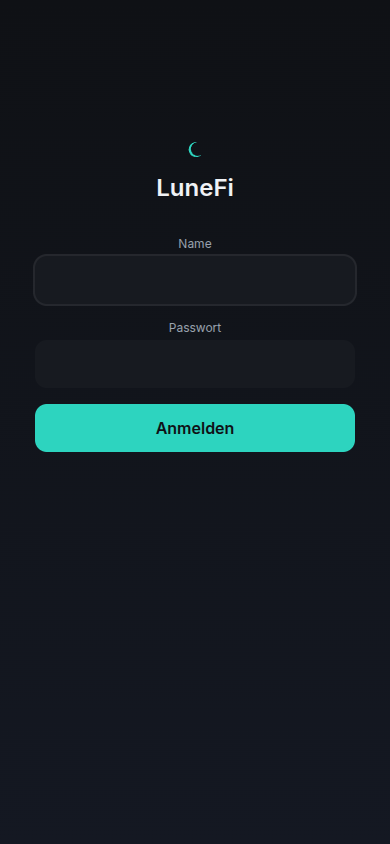
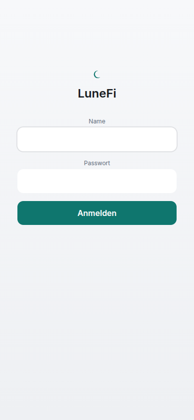
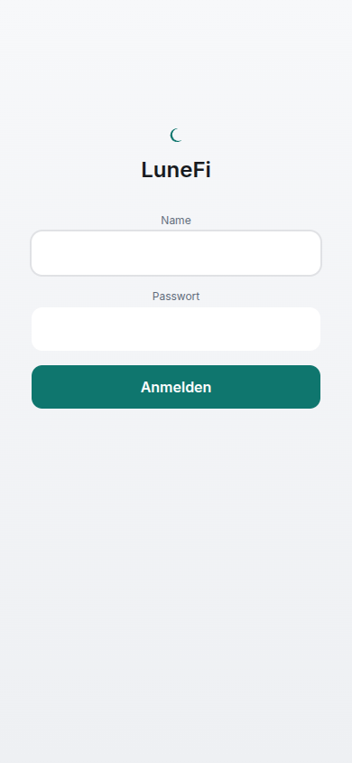
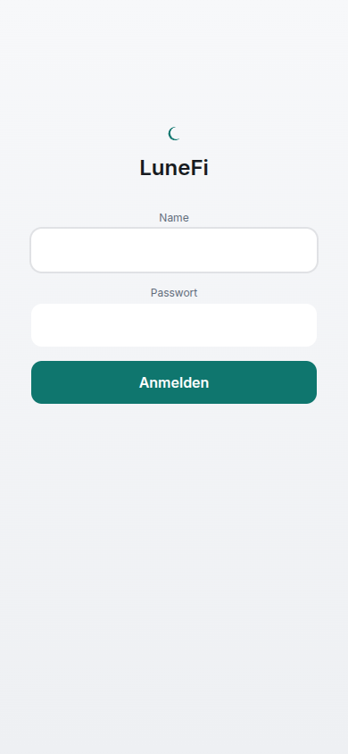
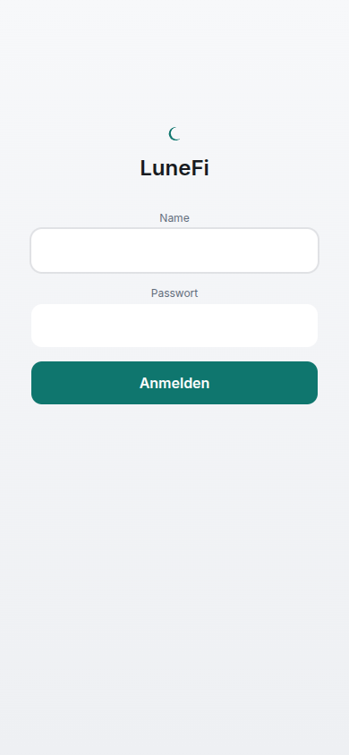
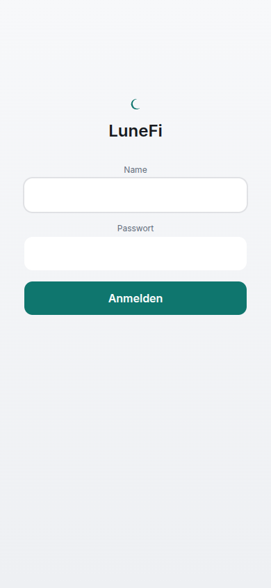
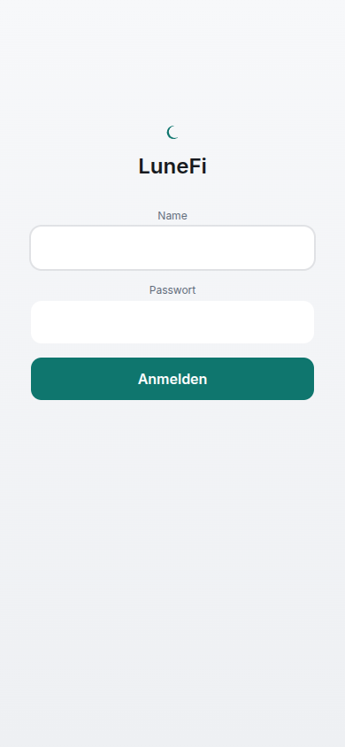
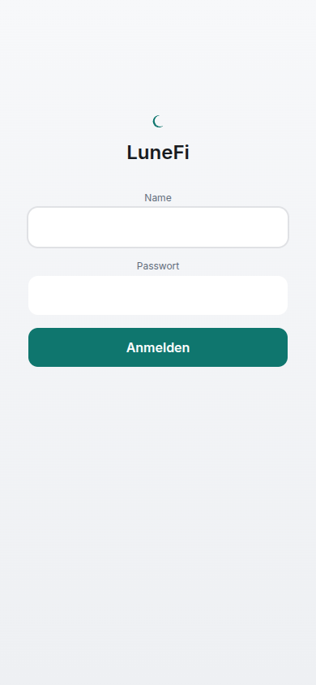
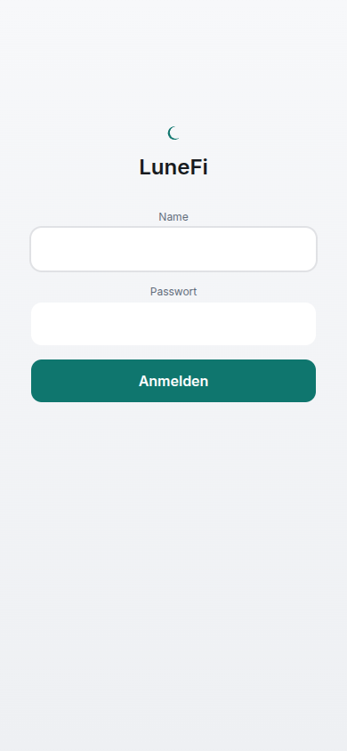

# LuneFi

Finanzen für zwei. LuneFi ist eine private App für ein Paar. Jeder sieht sein eigenes Geld. Gemeinsame Ausgaben werden geteilt. Am Monatsende sagt die App, wer wem wie viel schuldet.

## So sieht die App aus

**1. Anmelden.** Nur ihr beide kommt rein.



**2. Übersicht.** Saldo, Budget, Verlauf und die letzten Buchungen. Alles auf einen Blick, ohne Scrollen.



**3. Eintrag erfassen.** Selbst eingetragen bleibt eigenständig. Kommt der Umsatz später von der Bank, wird die Zeile nur bestätigt, nicht doppelt gezählt.



**4. Ausgleich.** Wer hat was vorgestreckt und wer bekommt wie viel. Ein Tippen genügt.



**5. Sparziele.** Fortschritt für gemeinsame Ziele. Es wird kein Geld bewegt, nur der Stand notiert.



**6. Statistik im Monat.** Wohin das Geld geht, als Kreis und Liste.



**7. Statistik im Jahr.** Alle Monate, Jahressummen und Kategorien des ganzen Jahres.


**8. Einstellungen.** Konten, Kategorien, Budgets und Hilfe.


**9. Konto anlegen.** Erst die Bank wählen, dann Name und Startsaldo. Die Bankverbindung für den Import kommt später dazu.



**10. Hilfe.** Jedes Konzept in einem Satz erklärt.



**11. Kategorie im Detail.** Ausgaben, Budget und Verlauf für eine Kategorie.



## Was die App kann

- Übersicht mit Saldo, Budget, Verlauf und Buchungen
- Manuelle Einträge, auch in mehrere Teile aufgeteilt
- Gemeinsame Ausgaben mit Anteilen und Zahler
- Monatlicher Ausgleich mit einem Tippen
- Sparziele mit Fortschritt
- Statistik für den Monat und für das Jahr
- Budgets je Kategorie mit Warnung
- Bankimport vorbereitet: Quellen, Zuordnung, keine Doppelten

## Wie sie gebaut ist

- Backend: Java mit Spring Boot und PostgreSQL
- Frontend: React mit TypeScript und Tailwind
- Alles ist testgetrieben über BDD

## Alles läuft über BDD

Jede Funktion beginnt als Szenario in deutscher Alltagssprache. Die Szenarien stehen in Gherkin im Ordner `features/`. Zuerst laufen sie rot. Dann wird so lange gebaut, bis sie grün sind. Danach verändert ein gezielter Eingriff in den Code das Ergebnis. Wenn ein Szenario dadurch rot wird, beweist das, dass es wirklich prüft. Das nennt sich Mutationstest.

Deutsch bleiben die Szenarien, die Oberfläche und die Schnittstellen nach außen. Der Code selbst ist englisch.

## Der Agenten-Workflow

Die App entsteht mit KI-Agenten nach einem festen Protokoll. Das Protokoll steht in `PROMPT.md` und gilt für jeden Agenten:

1. Spec und Szenarien zuerst, Code später.
2. Kleine Schritte, immer kompilierbar, immer rot vor grün.
3. Verifizieren mit echten Testläufen, nie mit Behauptungen.
4. Review über drei Achsen: Konventionen, Anforderung, Korrektheit.
5. Ergebnis in `REVIEW.md` festhalten.
6. Committen nur nach Anweisung.

Deshalb entspricht der Code im Repo immer den Szenarien im Repo.

## Lokal starten

```bash
docker compose up -d
LUNEFI_DEMO_SEED=true mvn spring-boot:run
cd frontend && yarn && yarn dev
```

Die Demo-Umgebung füllt die Datenbank mit Beispieldaten und legt die Testnutzer an. Ohne `LUNEFI_DEMO_SEED` startet die App leer und fragt beim ersten Aufruf nach den echten Nutzern.

## Struktur

```
specs/        Anforderungen in kurzen Regeln, für Menschen lesbar
features/     Gherkin-Szenarien, deutsch, eine Datei je Thema
src/          Backend (Spring Boot)
frontend/     Frontend (React, TypeScript)
steps/        Schritt-Definitionen für die Szenarien
docs/         Recherche und Screenshots
PROMPT.md     Das Protokoll für alle Agenten
```
